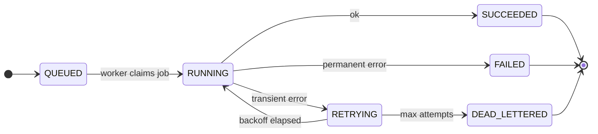

<div align="center">



<p>
  
  <a href="https://github.com/ParamSavjani?tab=followers"></a>
  <a href="https://portfolio.paramsavjani.in"></a>
  <a href="mailto:paramsavjani3010@gmail.com"></a>
</p>

</div>



## 💼 `git log --oneline career`

| | Where | What I engineered |
|:-:|---|---|
| 🧩 | **UnifyApps**<br/><sub>Intern</sub> | Workflow-automation integrations: **Microsoft Entra ID connectors** and an **async OpenAI connector** with **16 actions**. |
| 🚚 | **Fleetway**<br/><sub>Core Backend Intern · 10 months</sub> | Fuel-allocation algorithms, trip-lifecycle **state machines**, and a **PostgreSQL + MinIO migration** that cut query latency by **60%**. |
| 🤖 | **Quantseer**<br/><sub>AI platform</sub> | An **AI compliance monitoring platform** that scans call-center conversations for regulatory violations using LLM APIs. |

## 🧾 `cat ~/.config/param.yaml`

```yaml
apiVersion: engineer.param.dev/v1
kind: BackendEngineer
metadata:
  name: param-savjani
  labels: { role: backend, specialty: system-design, timezone: IST (UTC+05:30) }
spec:
  languages: [kotlin, java, python, typescript, rust]
  runtime: [spring-boot, node.js]
  storage: { relational: postgresql, document: mongodb, objects: minio }
  infra: [docker, github-actions, linux]
  observability: [grafana, structured-logs, metrics]
  patterns: [state-machines, async-workers, event-driven, caching]
  ai: [openai-api, llm-pipelines]
  designPrinciples:
    - every network call fails eventually; retry with backoff + jitter
    - writes are idempotent, or they are bugs waiting to happen
    - anything with a status column deserves an explicit state machine
    - measure first, then fix the p99, not the average
    - boring technology, interesting problems
status:
  phase: Running
  exploring: [distributed-systems, event-driven-architecture, llm-infra]
```

<details>
<summary><b>🔁 How I model an async job</b> (the pattern behind trip lifecycles at Fleetway)</summary>
<br/>



Every transition is explicit, persisted and idempotent, so a crashed worker can pick the job back up without double-processing.

</details>

## 🚀 Systems I've Built

| | Project | What it does | Stack |
|:-:|---|---|---|
| 📲 | **[Attendance IO](https://github.com/ParamSavjani/Attendance_IO_Backend)** | Campus attendance platform running in production: **1,000+** Play Store installs, **2,300+** students tracked | `Kotlin` `Spring Boot` `PostgreSQL` |
| 🎮 | **[Dots & Boxes](https://github.com/ParamSavjani/Dots-Boxes_Backend)** | Real-time multiplayer game, state synced over WebSockets across web and mobile | `TypeScript` `WebSockets` |
| 💰 | **[Hisaab Kitab](https://github.com/ParamSavjani/HisaabKitab)** | Expense tracker with bill splitting and friend-wise balances (a ledger problem in disguise) | `Node.js` `MongoDB` |
| 🌐 | **[Decentralized Reddit](https://github.com/ParamSavjani/Backend_DReddit)** | Reddit-style community platform on a decentralized backend | `Rust` `TypeScript` |

<details>
<summary>More projects</summary>
<br/>

- **[DAU Wi-Fi Auto-Login](https://github.com/ParamSavjani/daiict-wifi-auto-login)**: daemon that handles login/logout on DAU's captive Wi-Fi portal automatically (`Python` `systemd`)
- **Decentralized IPL Voting**: on-chain voting with ERC-20 tracking and Merkle-tree claim verification (`Solidity`)
- [telehealthcare](https://github.com/ParamSavjani/telehealthcare) · [chatting-app-param](https://github.com/ParamSavjani/chatting-app-param) · [University-Management](https://github.com/ParamSavjani/University-Management) · [Python-ML](https://github.com/ParamSavjani/Python-ML) · [Electronics_Hobby_Club](https://github.com/ParamSavjani/Electronics_Hobby_Club)

</details>

<p align="center"><sub><code>HTTP/1.1 200 OK</code> · Happy to talk about idempotent APIs, Postgres performance, state machines, or running LLMs in production 👋</sub></p>
