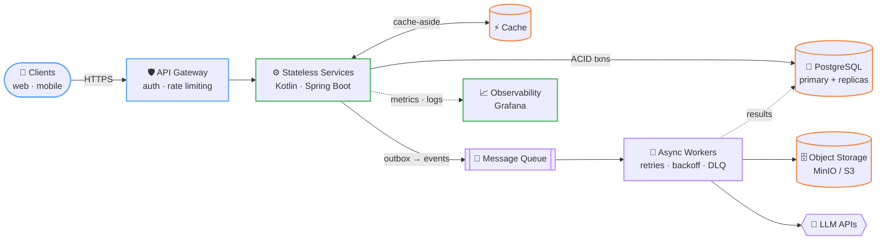
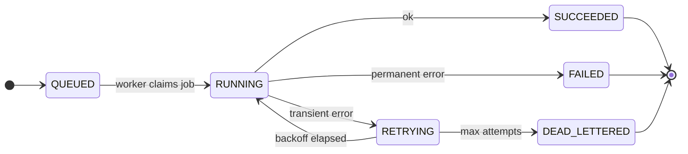

<div align="center">


<a href="https://portfolio.paramsavjani.in">
  
</a>

<p>
  
  <a href="https://github.com/ParamSavjani?tab=followers"></a>
  <a href="https://portfolio.paramsavjani.in"></a>
  <a href="mailto:paramsavjani3010@gmail.com"></a>
</p>

</div>

## 🧾 `cat ~/.config/param.yaml`

```yaml
apiVersion: engineer.param.dev/v1
kind: BackendEngineer
metadata:
  name: param-savjani
  labels:
    role: backend
    specialty: system-design
    timezone: IST (UTC+05:30)
spec:
  replicas: 1                     # vertically scaled with chai ☕
  languages: [kotlin, java, python, typescript, rust]
  runtime: [spring-boot, node.js]
  storage:
    relational: postgresql        # the source of truth
    document: mongodb
    objects: minio                # s3-compatible
  patterns: [state-machines, async-workers, event-driven, caching]
  observability: [grafana, structured-logs, metrics]
  ai: [openai-api, llm-pipelines]
  designPrinciples:
    - every network call fails eventually; retry with backoff + jitter
    - writes are idempotent, or they are bugs waiting to happen
    - anything with a status column deserves an explicit state machine
    - measure first, then fix the p99, not the average
    - boring technology, interesting problems
status:
  phase: Running
  exploring: [distributed-systems, event-driven-architecture, llm-infra]
  readinessProbe: always-shipping
```

## 📈 Impact


## 💼 `git log --oneline career`

| | Where | What I engineered |
|:-:|---|---|
| 🧩 | **UnifyApps**<br/><sub>Intern</sub> | Integrations for a workflow-automation engine: **Microsoft Entra ID connectors** and an **async OpenAI connector** exposing **16 actions**. |
| 🚚 | **Fleetway**<br/><sub>Core Backend Intern · 10 months</sub> | Fuel-allocation algorithms, trip-lifecycle **state machines**, and a **PostgreSQL + MinIO migration** that cut query latency by **60%**. |
| 🤖 | **Quantseer**<br/><sub>AI platform</sub> | An **AI compliance monitoring platform** that scans call-center conversations for regulatory violations using LLM APIs. |

> 📄 Full write-up of roles and projects: **[portfolio.paramsavjani.in](https://portfolio.paramsavjani.in)**

## 🧠 How I Design Systems

The shape most of my backends converge to: boring where it should be, async where it matters, observable everywhere.



| Concern | My default approach |
|---|---|
| **Reliability** | Timeouts on every call, retries with exponential backoff + jitter, circuit breakers, dead-letter queues |
| **Correctness** | Idempotency keys on writes, database constraints as the last line of defense, transactional outbox for events |
| **Data** | Normalize first, index for real query patterns, cursor pagination, zero-downtime migrations |
| **Performance** | Measure → profile → fix the p99; cache-aside with explicit TTLs; pooled connections |
| **Lifecycle** | Explicit state machines for anything with a status: trips, jobs, workflows |
| **Async & LLMs** | Slow or flaky work (LLM calls, file processing) goes to queues and workers, with timeouts, structured outputs and cost guardrails |
| **Operability** | Structured logs, RED metrics, dashboards and alerts before the first incident, not after |

<details>
<summary><b>🔁 Bonus: how I model an async job</b> (the same pattern behind trip lifecycles at Fleetway)</summary>
<br/>



Every transition is explicit, persisted and idempotent, so a crashed worker can pick the job back up without double-processing.

</details>

## 🚀 Systems I've Built

<table>
<tr>
<td width="50%" valign="top">

**📲 [Attendance IO](https://github.com/ParamSavjani/Attendance_IO_Backend)**<br/>
Campus attendance platform running in production: auto-generated timetables, one-tap marking, live analytics.<br/>
**1,000+** Play Store installs · **2,300+** students tracked<br/>
`Kotlin` `Spring Boot` `PostgreSQL` `React` `Firebase`<br/>
[Backend](https://github.com/ParamSavjani/Attendance_IO_Backend) · [Frontend](https://github.com/ParamSavjani/Attendance_IO_Frontend)

</td>
<td width="50%" valign="top">

**🎮 Dots & Boxes**<br/>
Cross-platform, real-time multiplayer game with game state synced over WebSockets across web and mobile clients.<br/>
`TypeScript` `WebSockets`<br/>
[Backend](https://github.com/ParamSavjani/Dots-Boxes_Backend) · [Frontend](https://github.com/ParamSavjani/Dots-Boxes_Frontend)

</td>
</tr>
<tr>
<td width="50%" valign="top">

**💰 [Hisaab Kitab](https://github.com/ParamSavjani/HisaabKitab)**<br/>
Real-time expense tracker with bill splitting and friend-wise balance calculation (a ledger problem in disguise).<br/>
`JavaScript` `Node.js` `MongoDB`

</td>
<td width="50%" valign="top">

**🗳️ Decentralized IPL Voting**<br/>
On-chain voting platform with ERC-20 tracking and Merkle-tree claim verification.<br/>
`Solidity` `ERC-20` `Merkle proofs`

</td>
</tr>
<tr>
<td width="50%" valign="top">

**🌐 [Decentralized Reddit](https://github.com/ParamSavjani/Backend_DReddit)**<br/>
Reddit-style community platform on a decentralized backend.<br/>
`Rust` `TypeScript`<br/>
[Backend](https://github.com/ParamSavjani/Backend_DReddit) · [Frontend](https://github.com/ParamSavjani/Reddit-decentralize)

</td>
<td width="50%" valign="top">

**📶 [DAU Wi-Fi Auto-Login](https://github.com/ParamSavjani/daiict-wifi-auto-login)**<br/>
Daemon that handles login/logout on DAU's captive Wi-Fi portal automatically.<br/>
`Python` `systemd`

</td>
</tr>
</table>

<details>
<summary>More repos</summary>
<br/>

| Repo | Stack | Description |
|---|---|---|
| [telehealthcare](https://github.com/ParamSavjani/telehealthcare) | TypeScript | Telehealth appointment and consultation platform |
| [chatting-app-param](https://github.com/ParamSavjani/chatting-app-param) | TypeScript | Real-time chat application |
| [University-Management](https://github.com/ParamSavjani/University-Management) | Java | College management system |
| [Python-ML](https://github.com/ParamSavjani/Python-ML) | Python | Machine learning experiments |
| [Electronics_Hobby_Club](https://github.com/ParamSavjani/Electronics_Hobby_Club) | TypeScript | Site for the college electronics club |

</details>

## 🛠️ Toolbox

| Layer | Tools |
|---|---|
| **Languages** |      |
| **Backend** |     |
| **Data** |     |
| **Infra & Ops** |     |
| **AI & Integrations** |   |
| **Frontend** |    |
| **Web3** |   |

## 📊 GitHub Activity

<p align="center">
  
</p>

<div align="center">

## 📫 Let's Talk Systems

<a href="mailto:paramsavjani3010@gmail.com"></a>
<a href="https://portfolio.paramsavjani.in"></a>
<a href="https://github.com/ParamSavjani"></a>

<sub>Happy to talk about idempotent APIs, Postgres performance, state machines, or running LLMs in production.</sub>

<br/><br/>

<code>HTTP/1.1 200 OK</code> · <code>Connection: keep-alive</code> · thanks for stopping by 👋

</div>
